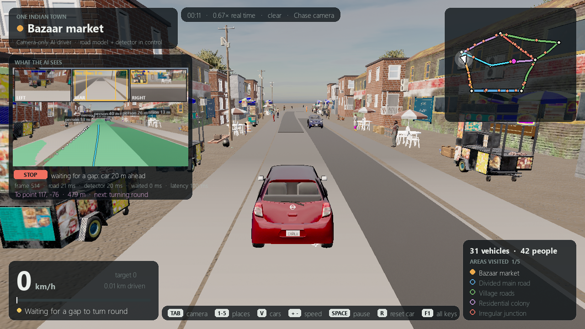

# Indian Road Perception Simulator

Road segmentation, object detection and a native CARLA town in which a car drives itself through Indian-style traffic using only what its cameras see.

The project combines a locked real-road segmenter, a separate synthetic-road segmenter, a 12-class detector and a connected left-hand-traffic town. In the town, one car is driven by the two trained models alone: the road model finds the road, the detector finds vehicles, riders and people, and the car keeps its lane, follows, stops, passes stopped buses, takes junctions, turns round on two-way streets and drives to a destination picked on the map. The other traffic follows rule-based controllers. A learned speed policy can choose the car's speed under a fixed safety shield.

## Features

- MobileNetV2/U-Net road segmentation with fixed preprocessing and checkpoint verification.
- YOLO11s detection of people, riders, vehicles, animals, traffic lights and traffic signs under a documented 12-class policy.
- Separate synthetic-road data/training with validity-masked labels and metrics.
- One OpenDRIVE town with market, colony, divided main road, rural road and irregular junction districts.
- **Camera-only driving**: lane keeping from the road model's mask, obstacle handling from detector boxes on flat ground, phantom-box rejection against the road mask, and a stuck-car recovery. The driver's source has no access to the simulator's map, routes or other actors.
- **Destinations**: click a point or place on the town map. A sat-nav plans on the lane graph, may reach the pin on either side of a two-way street, and turns round with a U-turn when that is shorter. Junctions are driven along a Hybrid A* path planned on the camera's top-down road grid, with turn-taking.
- **Rear and side cameras** that run only when needed: looking behind before passing and backing up, and watching traffic along the street while turning round.
- **Learned speed**: a PPO policy picks a fraction of the speed a fixed shield allows (posted limits, stopping curves, junction speeds), trained in a stand-in town and checked in CARLA.
- Native rule-driven traffic with route following, following gaps, junction rules, pedestrians and a bus service.
- Offline checks for every behaviour above, which run without CARLA or a GPU.

## Results

| Component | Recorded result | Evaluation scope |
| --- | --- | --- |
| Locked real-road segmentation | 91.6549% road IoU / 95.6457% Dice | 689 real test images; checkpoint/protocol fixed before test |
| Simulation-road segmentation | 99.9288% road IoU | 500 synthetic test images; 98.2174% valid coverage |
| YOLO11s detection | 62.245% mAP50 / 41.525% mAP50-95 | 17,675 project validation images, 1280 input, GPU FP32 |
| Connected town (rule traffic) | About 2.21 km across five districts | One 650-second seeded native check |
| Camera-only driving | 1.8-2.4 km in 600 s through 4-5 districts; 0-1 contacts per drive | Four 600-second drives, seed 8101, clear and dusk |
| Destinations | 3 of 3 and 4 of 4 destinations reached, stopping 0.2-0.5 m from each pin; one jaywalker contact per drive | One pair of 900-second drives, seed 8101 |
| Learned speed | Never over a posted limit (rule driver: 152-156 s over); about a quarter less hard braking | Three seeds of one destination list, against the rule driver |
| Turning round with side cameras | Turned round in 33 s without contact; held for a real motorcycle coming along the street | One CARLA drive, seed 8101, 26 Nov |

The metrics measure different tasks and datasets. Detector results use a project class mapping and filtered validation protocol, not the official full IDD benchmark. The driving results are simulation evidence on a few seeds; they are not a safety result. Read [results and limitations](docs/RESULTS.md) for conditions and underlying records.

## Quick start

Use Windows, official 64-bit Python 3.12 with the py launcher, PowerShell and a compatible graphics setup for CARLA 0.9.16. Run from the repository root:

    git clone https://github.com/lmaoitsatharv/indian-road-perception-simulator.git
    cd indian-road-perception-simulator
    .\setup\project\bootstrap_carla.ps1 -DownloadCarla
    .\Start_Combined_Indian_Traffic.ps1 -SimulationSeconds 120 -Quality Low

The bootstrap creates a separate .venv-carla environment and downloads/extracts the engine. Allow at least 30 GB free for the archive and installation. The rule-driven scene needs no datasets, checkpoints or MATLAB.

Camera-only driving additionally needs the two model checkpoints and their WSL GPU environments (see [getting started](docs/GETTING_STARTED.md#camera-only-driving)). Then:

    .\Start_Camera_Driving.ps1 -Destination "Colony junction"

In the town viewer, Tab switches camera, A shows the AI's view full screen, M opens the map to pick a destination, Space pauses/resumes, S saves a screenshot and Esc closes the owned session. See [camera driving](docs/CAMERA_DRIVING.md) and [simulation controls](INDIAN_SIMULATION.md).

## Source and model distribution

The repository contains source, clean notebooks, dependency specifications, model metadata, original small scene assets and curated results. Datasets, downloaded footage, trained weights, engine binaries, environments and complete experiment directories are external artifacts.

[Perception model metadata](models/perception_models.json) identifies recorded checkpoints, hashes and scopes. Inference also requires the relevant files and provenance; a source-only clone is not a ready-to-train model package. Keep TensorFlow, detector and CARLA runtimes separate because their package requirements differ.

## Documentation

- [Getting started](docs/GETTING_STARTED.md): installation, launchers and external artifacts.
- [Camera-only driving](docs/CAMERA_DRIVING.md): how the car drives, picks destinations and turns round, with the town results.
- [Learned speed](docs/RL_SPEED_RESULTS.md): the speed policy, its shield and its results.
- [Code map](docs/CODE_MAP.md): primary modules and data flow.
- [Results](docs/RESULTS.md): measured outcomes and limits.
- [Project from zero](docs/MILESTONE_2_VIVA_GUIDE.md), [progress report](docs/MILESTONE_2_PROGRESS.md) and [file-by-file guide](docs/FILE_GUIDE.md).
- [Roadmap](docs/NEXT_STEPS.md): what is done and what remains.
- [Documentation index](docs/INDEX.md): technical guides by topic.
- [Security](SECURITY.md): local services, checkpoint trust and repository safeguards.

## Current limits

Camera-only driving is tested on a few seeds of one synthetic town, mostly in clear weather. Its distances come from flat-ground and typical-width estimates, not depth sensors. Junctions are its weakest part: it can cut the inside of a sharp turn, and it relies on the other drivers giving way. In wet weather the road model takes wet sand beside the road for road. The learned speed policy gains little over its own shield; most of the improvement comes from the shield's rules.

Road masks do not establish obstacle-free space or lane legality. Detector traffic-light/sign categories do not supply light state or sign meaning. Generic assets, correlated synthetic layouts, close clearances, transient jerk and runtime interruptions limit the existing evidence. Finite zero-collision checks do not establish real-road safety.

## Team

- [Atharv](https://github.com/lmaoitsatharv)
- [Sarthak](https://github.com/Tumgharag)

See [team ownership](docs/TEAM_OWNERSHIP.md) for who built which module.

## Contributing

See the [contribution guide](CONTRIBUTING.md) for the branch, review and evaluation workflow.

Read the code map and relevant evaluation protocol before changing a module. Preserve model/split contracts, use fresh experiment directories, distinguish prediction from control and report failed/regressing cases. Include evaluation scope with performance claims. Keep datasets, weights, credentials and generated runs outside source commits. The staged-content guard at setup/project/check_repository.py checks common publication mistakes; it is not an exhaustive security scan.
