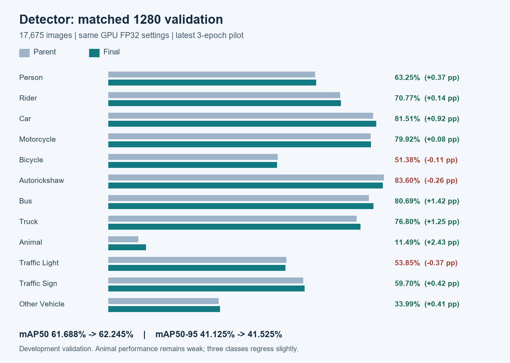
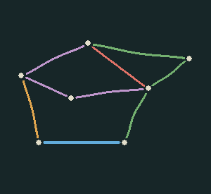
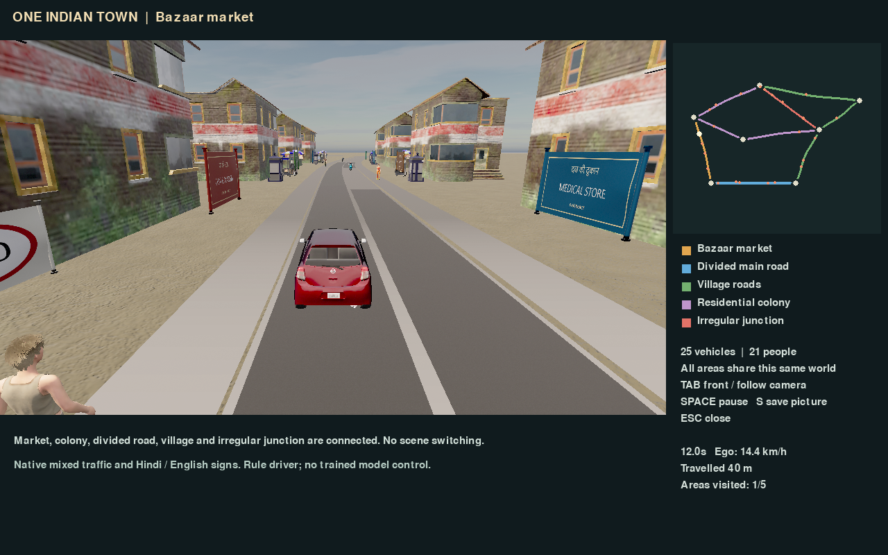
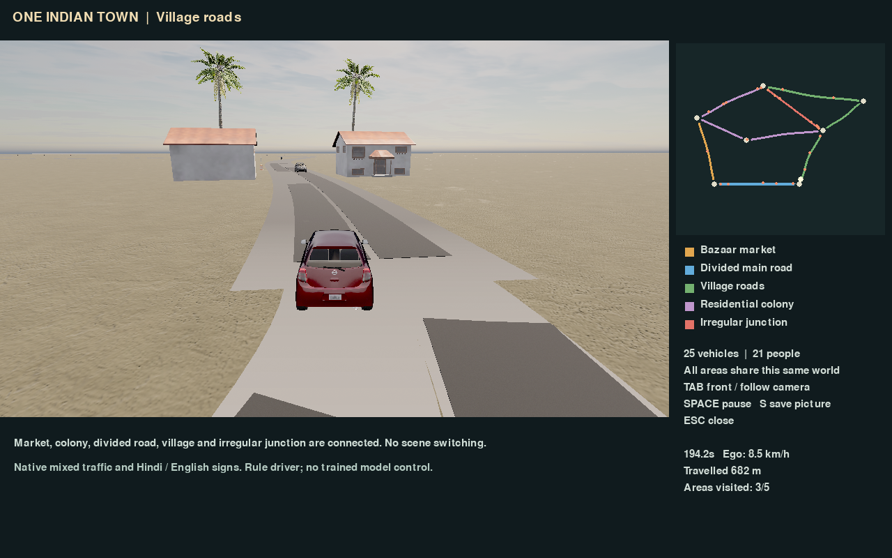
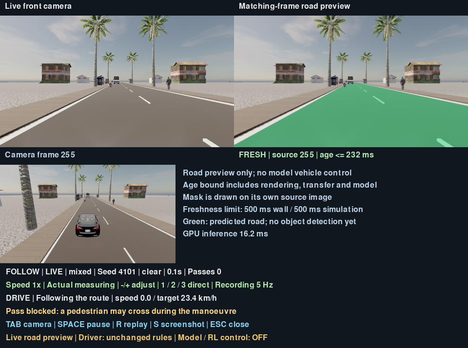

# Milestone 2 evidence gallery

These are selected original synthetic captures and an aggregate chart built from saved results. They are suitable for explaining progress. No provider dataset photographs, downloaded footage, checkpoint binaries or raw run directories are uploaded with them.

## Latest detector comparison

All 17,675 validation images / 319,438 labelled objects, GPU FP32, 1280 input and matched standalone evaluator settings. Average mAP50 rises 61.688% to 62.245%; mAP50-95 rises 41.125% to 41.525%. Animal remains weak; bicycle, autorickshaw and traffic-light AP50 regress slightly. These are development validation results, not an independent test. [Raw matched evidence](results/detection_resolution_pilot.json).

## One connected town

This small schematic records the connected road graph. Five districts share one native world. The source specifies seven junction nodes and nine streets, with lane connectors; it is an illustrative synthetic town, not an imported real-city map. User-selectable destinations are not implemented. [Town report](COMBINED_INDIAN_TOWN.md).

Selected market-district view from the native connected-town evidence. Installed generic meshes and project-authored signs provide the streetscape. It illustrates scene construction, not camera-based control.

Selected rural-road view from the same connected-town evidence. The saved long check retained one world and vehicle identities across district boundaries. A selected capture is not a broad weather/traffic benchmark.

## Live road-model observation

The earlier smaller-neighbourhood live preview displays the simulation model's mask on its matching source frame. Its own HUD explicitly says observation-only, no model vehicle control and no object detection in this view. The rule driver remains active. The displayed inference/age values are for this particular capture, not the full run's medians. [Timing and limits](LIVE_SIMULATION_OBSERVATION.md).

## What to say beside these figures

Explain the model task and evaluation scope first, then how the scene/control works. Label destination navigation, model-to-control integration, tracking and later RL as remaining work. Use the [progress report](MILESTONE_2_PROGRESS.md) and [beginner guide](MILESTONE_2_VIVA_GUIDE.md) for a consistent explanation.

[Image provenance and SHA-256 fingerprints](results/milestone2/evidence_manifest.json) preserve the original source locations and verify that the copied captures match. The handoff does not rerun these experiments or change the models.
