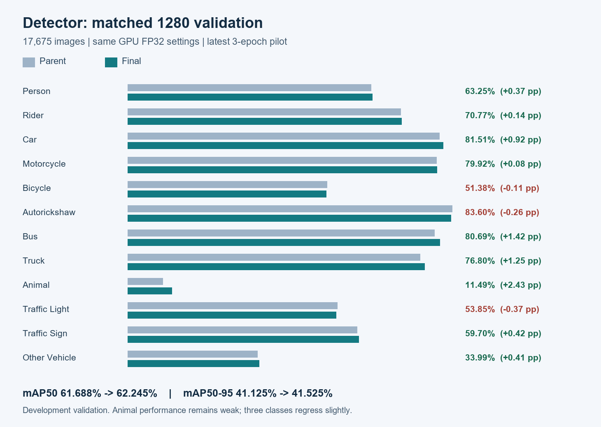
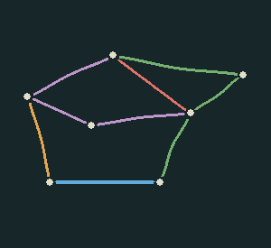
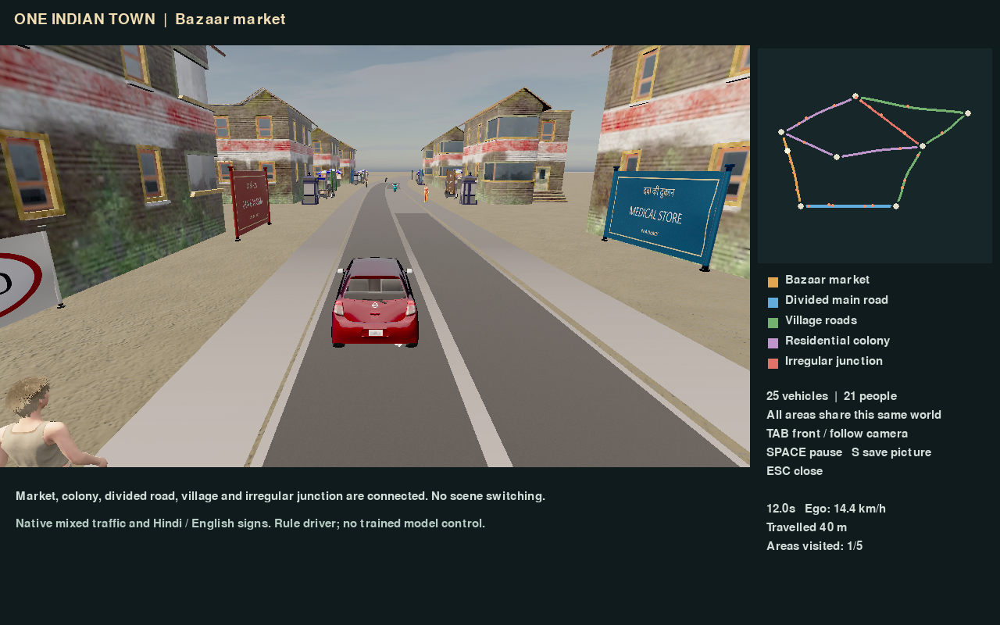
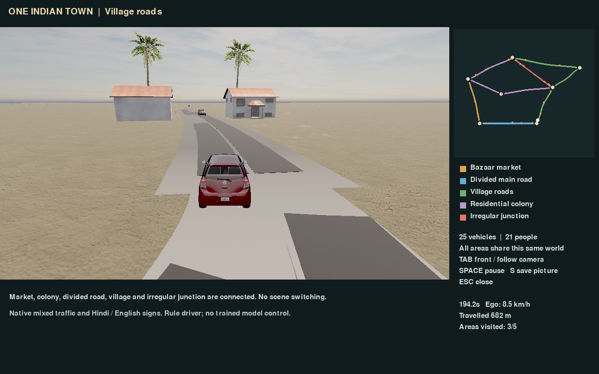
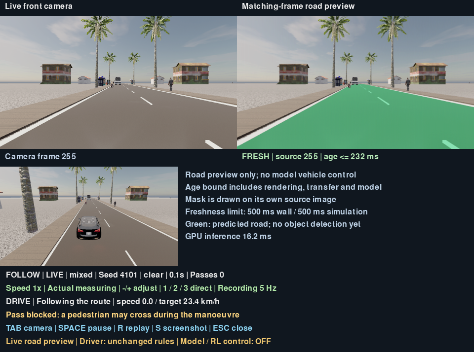

# Results and evaluation scope

This page collects measured results for the road models, object detector and traffic simulation. Each result belongs to its stated task, split and protocol. Selected captures illustrate the system; they do not establish performance in every condition.

## Summary

| Component | Result | Evaluation scope |
| --- | --- | --- |
| Locked real-road segmentation | 91.6549% road IoU / 95.6457% Dice | 689 real test images; checkpoint and threshold fixed before test access |
| Simulation-road segmentation | 99.9288% road IoU | 500 synthetic test images; 98.2174% valid pixels |
| Simulation fresh-scene confirmation | 99.7478% road IoU | 480 frames across eight changed synthetic runs |
| Object detector | 62.245% mAP50 / 41.525% mAP50-95 | 17,675 project validation images, 1280 input, GPU FP32 |
| Connected town | About 2.21 km through five districts in one native world | One 650-second seeded continuous run with rule-driven traffic |

The detector uses a project class mapping and filtered validation membership. Its result is development validation, not an official IDD benchmark or an independent labelled test. The real-road and simulation percentages measure different distributions. Neither is an evaluation of camera-driven collision avoidance.

## Detector comparison

The three-epoch adaptation compares the same 17,675 validation images / 319,438 objects, GPU FP32 and 1280 input before and after learning. mAP50 rises 61.688% to 62.245%, and mAP50-95 rises 41.125% to 41.525%: gains of 0.557 and 0.400 percentage points. Animal remains weak; bicycle, autorickshaw and traffic-light AP50 decline slightly. [Matched report](DETECTION_RESOLUTION_PILOT_RESULT.md) and [raw summary](results/detection_resolution_pilot.json).

Later development work (project validation only, not deployed; the summary row above is unchanged): the [detector error review](DETECTION_ERROR_REVIEW_20261028.md) records the 1536 / NMS 0.6 inference-setting test, and the [filtered animal view and land-only re-score](ANIMAL_FILTER_RESCORE_PLAN_20261029.md) records an overnight fine-tune whose checkpoint is not deployed.

## Connected native town

Five districts share one native world, with seven junction nodes, nine streets and 36 directed lane connectors. The layout is original and illustrative. Current routes are preset; user-selected destinations remain planned.

The continuous check retained one world and the same 25 vehicle identities, with 21 pedestrians present. No vehicle contacts, sampled overlaps, centre departures or direction errors were recorded under that check. The minimum sampled gap was 0.273 m, so tight clearances remain a limitation. Native controls use rules and simulator states. [Connected-town report](COMBINED_INDIAN_TOWN.md) and [summary](results/combined_indian_town.json).

A later 900-second run of the same town (seed 8101) ended in a gridlock: every vehicle stopped from about 787 s to the end, while the run still reported `passed` because the pass check does not measure progress. The likely cause is in the junction-token logic; it is diagnosed but not fixed. See [the gridlock diagnosis](TOWN_GRIDLOCK_DIAGNOSIS_20261029.md).

## Live road observation

The road mask is displayed on its own source frame in the smaller neighbourhood scene. It remains observation-only; the traffic controller does not receive model predictions. The HUD values in this selected capture are not the full run's medians.

The normal check received 100/100 results with no reconnects. Median GPU inference was 17.31 ms, source-step-to-result age upper bound 60.36 ms and first presentation age upper bound 120.11 ms. Two intervals retained an overlay beyond the 500 ms target until redraw, by up to 14.87 ms. This is a measured scheduling limitation, not a strict real-time guarantee. [Live observation report](LIVE_SIMULATION_OBSERVATION.md).

## Evidence and reproduction

- [Real segmentation result](results/segmentation.json).
- [Synthetic test](SIMULATION_TEST.md) and [fresh confirmation](SIMULATION_CONFIRMATION.md).
- [Earlier finite overtaking/junction scenario report](results/carla/SCENARIO_REPORT.md).
- [Capture fingerprints](results/overview/evidence_manifest.json).

Data, checkpoint binaries, source footage and complete run directories are acquired separately. Public summaries retain relative identities for the recorded experiments. Historical local-gallery paths require those artifacts; they are not bundled into a source checkout. Future model selection must use development data rather than repeatedly tuning against already inspected test results.
