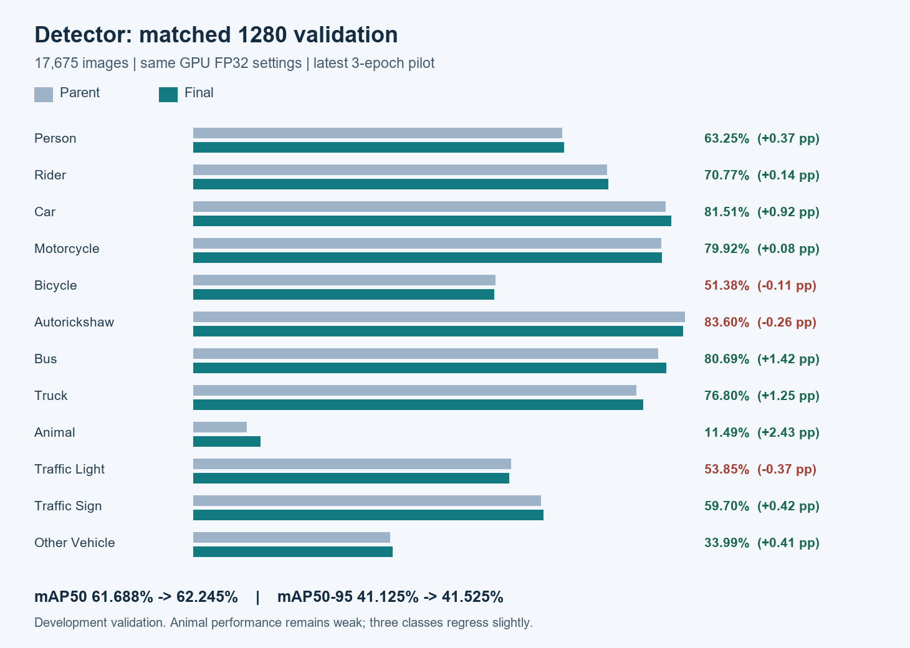
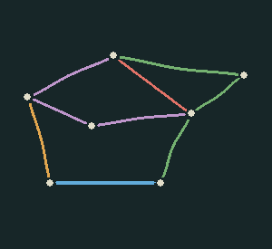
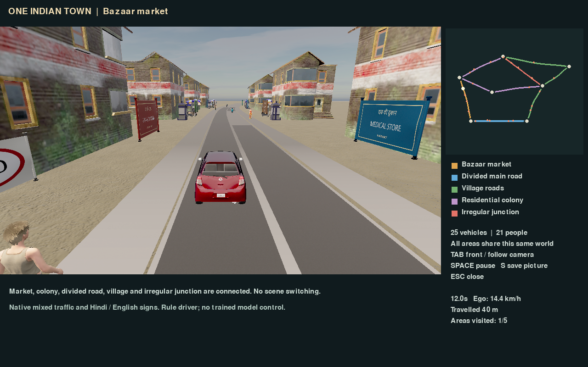
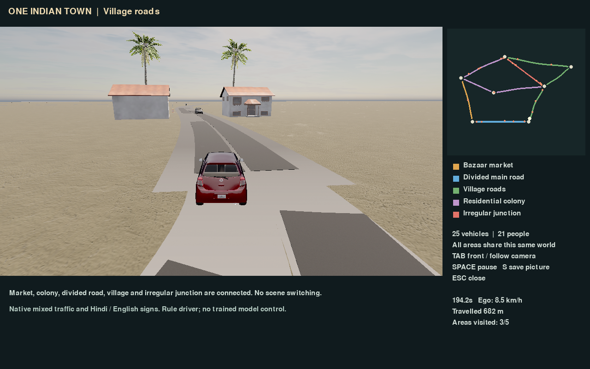
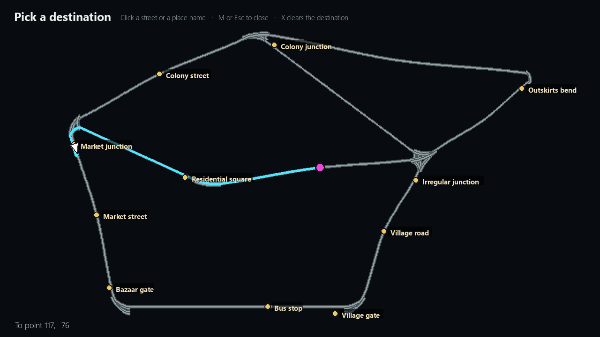
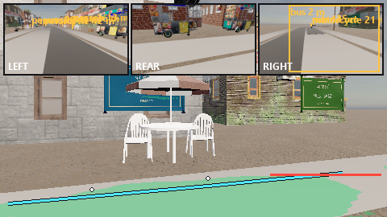
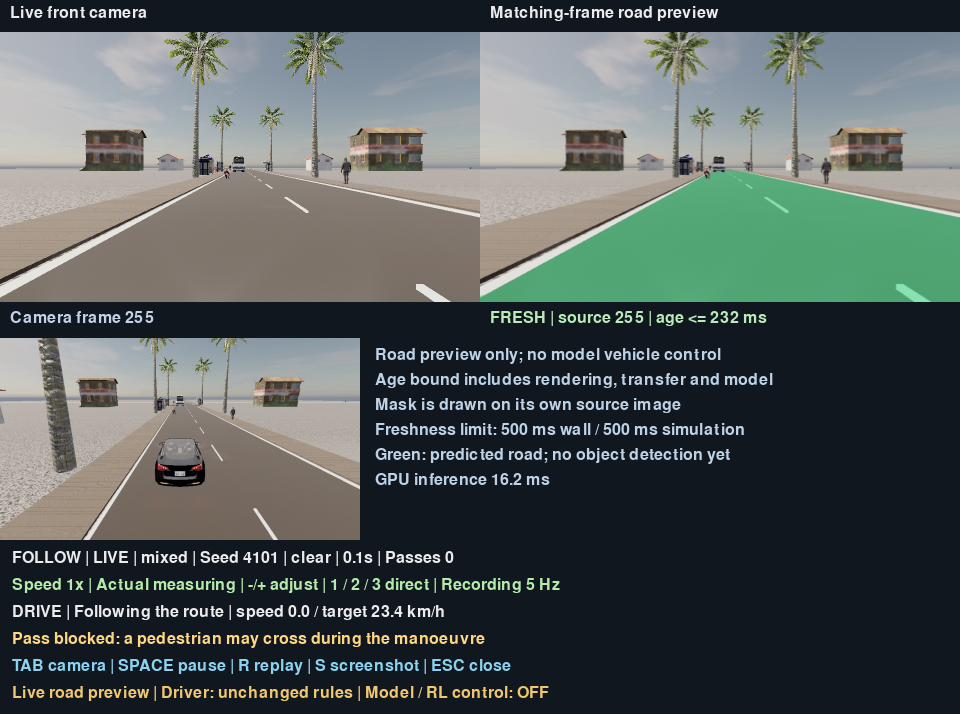

# Results and evaluation scope

This page collects measured results for the road models, object detector, traffic simulation and camera-only driving. Each result belongs to its stated task, split and protocol. Selected captures illustrate the system; they do not establish performance in every condition.

## Summary

| Component | Result | Evaluation scope |
| --- | --- | --- |
| Locked real-road segmentation | 91.6549% road IoU / 95.6457% Dice | 689 real test images; checkpoint and threshold fixed before test access |
| Simulation-road segmentation | 99.9288% road IoU | 500 synthetic test images; 98.2174% valid pixels |
| Simulation fresh-scene confirmation | 99.7478% road IoU | 480 frames across eight changed synthetic runs |
| Object detector | 62.245% mAP50 / 41.525% mAP50-95 | 17,675 project validation images, 1280 input, GPU FP32 |
| Connected town | About 2.21 km through five districts in one native world | One 650-second seeded continuous run with rule-driven traffic |
| Camera-only driving | 1.8-2.4 km in 600 s, 4-5 districts, 0-1 contacts per drive | Four 600-second drives, seed 8101, clear and dusk |
| Destinations | 3 of 3 and 4 of 4 reached, 0.2-0.5 m from each pin | One pair of 900-second drives, seed 8101 |
| Learned speed | Never over a posted limit; about a quarter less hard braking than the rule driver | Three seeds of one destination list, CARLA |

The detector uses a project class mapping and filtered validation membership. Its result is development validation, not an official IDD benchmark or an independent labelled test. The real-road and simulation percentages measure different distributions. The driving rows are simulation results on few seeds of one synthetic town; they are not safety evidence.

## Detector comparison

The three-epoch adaptation compares the same 17,675 validation images / 319,438 objects, GPU FP32 and 1280 input before and after learning. mAP50 rises 61.688% to 62.245%, and mAP50-95 rises 41.125% to 41.525%: gains of 0.557 and 0.400 percentage points. Animal remains weak; bicycle, autorickshaw and traffic-light AP50 decline slightly. [Matched report](DETECTION_RESOLUTION_PILOT_RESULT.md) and [raw summary](results/detection_resolution_pilot.json).

Later development work (project validation only, not deployed; the summary row above is unchanged): the [detector error review](DETECTION_ERROR_REVIEW_20261028.md) records the 1536 / NMS 0.6 inference-setting test, and the [filtered animal view and land-only re-score](ANIMAL_FILTER_RESCORE_PLAN_20261029.md) records an overnight fine-tune whose checkpoint is not deployed.

## Connected native town

Five districts share one native world, with seven junction nodes, nine streets and 36 directed lane connectors. The layout is original and illustrative. The rule-driven traffic follows preset routes; the camera-driven car can be sent to any picked destination (below).

The continuous check retained one world and the same 25 vehicle identities, with 21 pedestrians present. No vehicle contacts, sampled overlaps, centre departures or direction errors were recorded under that check. The minimum sampled gap was 0.273 m, so tight clearances remain a limitation. Native controls use rules and simulator states. [Connected-town report](COMBINED_INDIAN_TOWN.md) and [summary](results/combined_indian_town.json).

A later 900-second run of the same town (seed 8101) ended in a gridlock: every vehicle stopped from about 787 s to the end, while the run still reported `passed` because the pass check does not measure progress. The junction-token logic has since been fixed and a progress check added to the pass gate; a full 900-second run with every rule (4 Nov, simulation, seed 8101) then passed with no contacts and 24 of 25 vehicles still moving after 786 s (the other is the bus at its service stop). That is one traffic pattern, because the seed only changes car colours. See [the gridlock diagnosis](TOWN_GRIDLOCK_DIAGNOSIS_20261029.md).

## Camera-only driving

One car in the town is driven by the simulation road model and the deployed detector alone, looking through one front camera (plus rear and side cameras around passes and turns). The driver's source has no access to the simulator's map, routes or other actors; an offline check enforces that. The other 24 vehicles and all the people follow their rules. [Camera driving](CAMERA_DRIVING.md) describes the behaviour and every run.

| Measure | Run04, clear | Run06, clear | Run11, clear | Run12, dusk |
| --- | --- | --- | --- | --- |
| Distance in 600 s | 2.40 km | 2.09 km | 1.80 km | 2.03 km |
| Districts | 4 of 5 | all 5 | all 5 | 4 of 5 |
| Contacts involving the car | 0 | 0 | 1 (static object, after leaving the road) | 0 |
| Resets (stuck for 30 s) | 0 | 2 | 2 | 1 |
| Lane centre outside junctions, median / p90 | 0.15 / 1.06 m | 0.10 / 0.20 m | 0.07 / 0.57 m | 0.15 / 0.75 m |

Each drive ran on slightly different code, because each found something that was then fixed. The bus stopped at its stop was passed in every drive; at dusk, on a second visit, two passes were given up.

## Destinations and turning round

A destination is picked by clicking the town map. The sat-nav plans on the town's lane graph from the car's position; between junctions the car still follows the kerb it sees, and through junctions it follows a Hybrid A* path planned on the camera's top-down road grid (19-31 ms per plan, median). In a pair of 900-second drives on two destination lists, every leg was driven to its pin and the car stopped 0.2-0.5 m from it; each drive touched the same jaywalker once, which led to a crossing-pedestrian rule. Later pairs reached fewer destinations in 900 s, mostly because of long waits for a turn at busy junctions.

Since 18 November a destination may be reached on either side of a two-way street, and the route may turn round with a U-turn when that saves going round the block (the 18 November case: 677 m instead of 1836 m). The car waits for a gap, then turns on full lock forward and back between the road's edges.

| Turn | Time from the first move | Moves | Contacts | Held by |
| --- | --- | --- | --- | --- |
| First CARLA run (18 Nov) | stuck; reset after 80 s | - | 0 | a stall on the pavement read as a truck behind |
| Second run (18 Nov) | 46 s | 6 | 0 | phantom boxes behind, about 20 s |
| With side cameras (26 Nov) | 33 s | 5 | 0 | a real motorcycle coming along the street, about 4 s |

Across the street, traffic along it is beside the car, where only the side cameras see it; a move stops while anything on the road within 20 m comes towards the car. In the 26 November run that hold was right for a motorcycle closing at 4.4 m/s (ground truth) and wrong for about 1 s in all. Later in that run the car cut the inside of a sharp left at a junction and pushed on a kerb for 29 s until the town's reset; it now backs off after 2 s (checked offline, not yet in CARLA).

## Learned speed

A PPO policy chooses a fraction of the speed a fixed shield allows. The shield holds every safety rule of the camera driver plus the sat-nav's posted limits, so the policy can only be slower than it, never faster. It was trained in a stand-in town and checked there and in CARLA. [Design](RL_SPEED_DESIGN_20261112.md) and [results](RL_SPEED_RESULTS.md).

| Seed (destination list 1) | Last arrival, rule / learned | Over a limit at all, rule / learned | Hard braking, rule / learned | Collisions |
| --- | --- | --- | --- | --- |
| 8101 | 680.2 / 690.5 s | 156.1 s / 0 s | 14.3 / 10.2 s | 0 / 0 |
| 42 | 684.9 / 693.1 s | 154.9 s / 0 s | 14.2 / 10.6 s | 0 / 0 |
| 7 | 697.0 / 700.4 s | 152.2 s / 0 s | 16.9 / 14.7 s | 0 / 0 |

The learned car never exceeded a posted limit and braked hard about a quarter less. On this list, mostly 4.4-5.0 m/s market and colony streets where the rule driver's 5.5 m/s is over the limit, it arrived 3-10 s later. In 990 held-out stand-in-town drives it was 2.6-3.0% faster than the rule driver with no collision; almost all of that comes from the shield (posted limits held precisely, easing into junctions), not from the learning.

## Live road observation

The road mask is displayed on its own source frame in the smaller neighbourhood scene. It remains observation-only; the traffic controller does not receive model predictions. The HUD values in this selected capture are not the full run's medians.

The normal check received 100/100 results with no reconnects. Median GPU inference was 17.31 ms, source-step-to-result age upper bound 60.36 ms and first presentation age upper bound 120.11 ms. Two intervals retained an overlay beyond the 500 ms target until redraw, by up to 14.87 ms. This is a measured scheduling limitation, not a strict real-time guarantee. [Live observation report](LIVE_SIMULATION_OBSERVATION.md).

## Evidence and reproduction

- [Real segmentation result](results/segmentation.json).
- [Synthetic test](SIMULATION_TEST.md) and [fresh confirmation](SIMULATION_CONFIRMATION.md).
- [Earlier finite overtaking/junction scenario report](results/carla/SCENARIO_REPORT.md).
- [Capture fingerprints](results/overview/evidence_manifest.json).

Data, checkpoint binaries, source footage and complete run directories are acquired separately. Public summaries retain relative identities for the recorded experiments. Historical local-gallery paths require those artifacts; they are not bundled into a source checkout. Future model selection must use development data rather than repeatedly tuning against already inspected test results.
