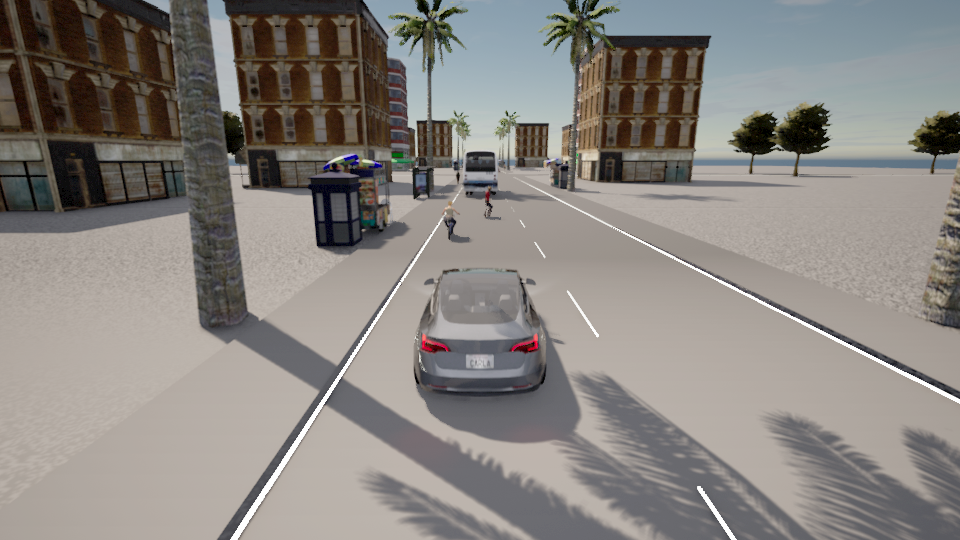
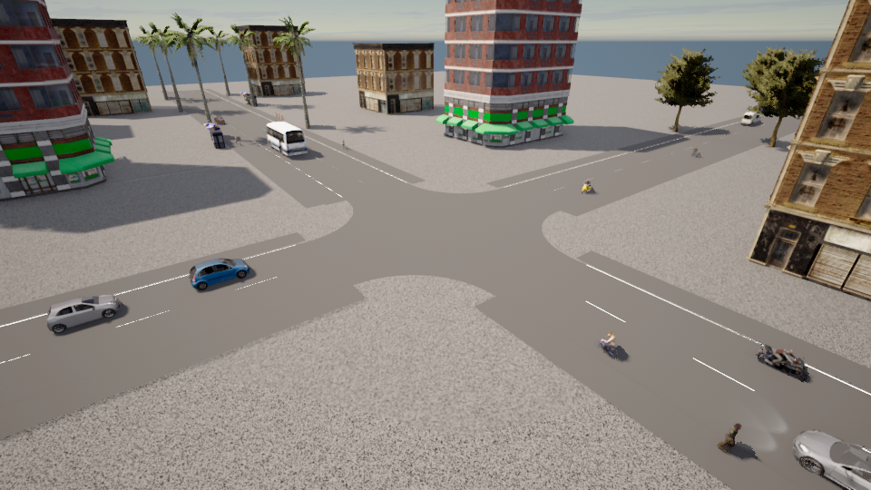
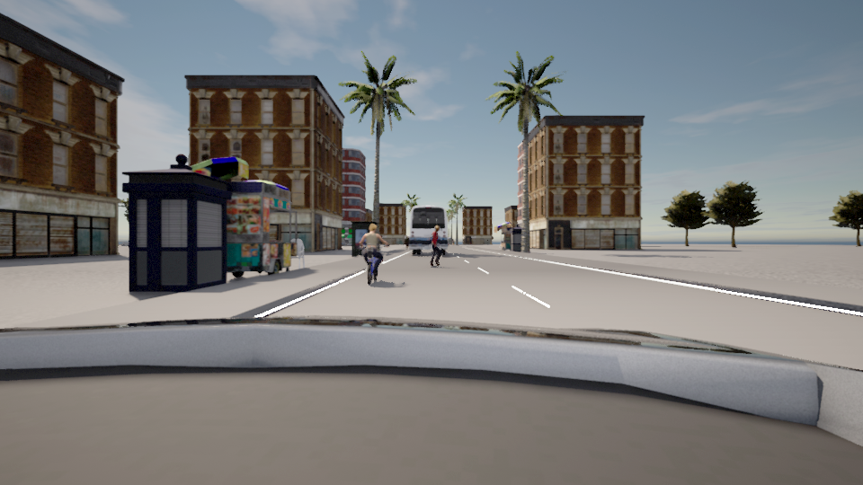

# Indian traffic scenario — checked build, 19 October 2026

## What is ready

Native 3D CARLA neighbourhood with a true left-hand road network, twelve junction routes, follow/driver/junction cameras, mixed vehicle sizes, walking and crossing people, bus stopping, roadside activity and a separate parking bay. Vehicles use throttle, brake and steering in CARLA physics. There are no driving pose teleports or disabled collisions.

Play **Start_Indian_Traffic.cmd**. Use **Tab** for cameras, **Space** to pause, **R** to start a fresh episode, **S** to save an image and **Esc** to close. The default session lasts at most ten minutes and pauses at the ego goal. Use the window titled **Indian traffic neighbourhood**; a separate CARLA engine window may also be present.

The scene has 11 vehicles including the ego and parked car, and 8 people in the mixed scenario. There is a scooter, motorcycle, two cycles, bus, van and several cars. These are available CARLA assets, not authentic models for every Indian vehicle class.

## Verified results

Seven completed scenario checks are selected below. All have zero native vehicle collision events, zero sampled traffic-body overlaps, zero road departures and zero wrong-way events. Their saved images match the corresponding world-frame timestamps. Body checks include moving people and the parked car; they are two-dimensional checks at 20 Hz on this flat map, with native collision sensors on every vehicle.

| Scenario | Seed | Simulated duration | Ego travel | Completed passes | Ego goal | Closest sampled traffic-body gap | Independent audit |
| --- | ---: | ---: | ---: | ---: | --- | --- | --- |
| clear_overtake | 7 | 60 s | 237.69 m | 1 | 44.45 s | 0.843 m | Pass |
| oncoming | 7 | 60 s | 154.83 m | 0 | Not reached within this test | 2.496 m | Pass |
| pedestrian | 7 | 60 s | 237.81 m | 0 | 51.80 s | Not within the 4 m audit search band | Pass |
| return_gap | 7 | 60 s | 237.80 m | 1 | 44.50 s | 0.815 m | Pass |
| junction | 7 | 60 s | 237.81 m | 0 | 56.25 s | 2.852 m | Pass |
| mixed | 7 | 110 s | 237.81 m | 1 | 81.95 s | 0.174 m | Pass |
| mixed | 42 | 110 s | 237.81 m | 1 | 81.95 s | 0.235 m | Pass |

The oncoming case intentionally keeps the ego behind the cyclist while the pass is blocked. Route completion is not claimed for a case where the goal was not reached. Both 110-second mixed cases must reach their declared goal to pass the final audit.

The case requirements are checked against actual events: a completed clear-road pass, initial oncoming blockage, a direct ego yield and completed pedestrian crossing, a merge delayed by the return-gap scooter, and a junction yield/release. Runtime success alone cannot satisfy these requirements.

## Ride quality

Actual motion is measured from positions. The following braking/jerk values use half-second differences, consistently across builds, to reduce amplification of frame-level position noise. The raw 20 Hz peak values remain in each result and can be much larger. A controller command limit is not a measured comfort guarantee.

| Scenario / seed | Max ego speed (m/s) | Max braking over 0.5 s (m/s²) | Absolute jerk p95 over 0.5 s (m/s³) | Max absolute jerk over 0.5 s (m/s³) |
| --- | ---: | ---: | ---: | ---: |
| clear_overtake / 7 | 7.11 | 4.60 | 3.15 | 16.08 |
| oncoming / 7 | 5.40 | 1.33 | 0.39 | 16.09 |
| pedestrian / 7 | 7.11 | 4.58 | 5.02 | 16.09 |
| return_gap / 7 | 7.11 | 4.64 | 3.21 | 16.08 |
| junction / 7 | 7.11 | 4.54 | 4.65 | 16.03 |
| mixed / 7 | 7.11 | 4.63 | 4.14 | 16.09 |
| mixed / 42 | 7.11 | 4.63 | 4.14 | 16.09 |

The earlier clear-road build recorded 12.37 m/s² braking and 9.10 m/s³ jerk p95. The checked controller reduces those observed values in that case. Stopping positions and headway were also corrected, so this is a build comparison, not an isolated causal experiment. High transient jerk and emergency braking still need further work and calibration.

## Problems found and addressed

1. **Incorrect early pass prediction:** a stopped oncoming car could accelerate after a pass began. The gate now accounts for its target approach speed, and the controlled oncoming case must show a blocked pass.
2. **A masked pedestrian test:** a slow cycle was doing the yielding in front of the ego. The direct-yield test now isolates the ego response.
3. **Overwide bus placement:** the installed bus's conservative body rectangle did not fit its roadside offset. It is now centred within its carriageway.
4. **Overlapping people:** crossing endpoints were moved to the outer footpath, separated from walking tracks. People already crossing continue walking while vehicles yield. Mixed-scene pedestrians first accept a vehicle gap.
5. **Unnecessary junction queues:** geometric conflict reservations permit compatible opposing flows and following traffic, while conflicting paths retain priority rules and headway checks.
6. **Destination blockage:** NPCs formerly stopped at the ego's destination. The ego now has its own finish point near x=112 m; NPC stopping areas are farther toward the map edge. Parking is in a separate bay.
7. **Abrupt stopping and overspeed:** earlier braking, longer headway, anti-windup, acceleration feedback and lower normal brake commands reduce the measured harshness. All raw metrics remain saved.
8. **GPU renderer failures:** the experimental off-screen launch failed with VK_ERROR_SURFACE_LOST_KHR and was removed. An accelerated windowed suite later failed with VK_ERROR_DEVICE_LOST. The accepted long mixed checks use fresh, windowed sessions at the 20 Hz cap. These GPU failures remain in the owner's local native failure records; broad long-session renderer reliability is not proven.
9. **Slow failure reporting:** actor bounds are cached at spawning, runtime RPC waits are bounded to ten seconds, and the launcher watches new native crash records belonging to process IDs from its own Windows Job Object. The ownership filter was checked against saved real crash evidence and a foreign PID.

The replay key was exercised: it removed the previous actors, created a new ego actor, restored the same starting position and preserved the earlier episode. Pause/resume checks verified an unchanged world frame; camera changes and screenshots exercised the actual key handlers.

## Actual captures

## Evidence

This portable selection includes audits, actor settings, results, incidents, configs and three synthetic captures. Full per-frame traces, camera records, source snapshots and failed runs remain in the owner's local runs/ folders; they are not part of this Git repository.

The first four accepted controlled cases preceded the actor-bound caching change. The saved `controlled_to_final_policy.diff` confirms that only when bounds are fetched changed; the controller rules and road/scenery files are unchanged. Junction and mixed checks then passed with cached bounds and the real-time cap. The final camera-eye adjustment was visually checked in a separate live preview and is recorded in `camera_review.json`.

- [clear_overtake / seed 7](clear_overtake_seed7/independent_audit.json)
- [oncoming / seed 7](oncoming_seed7/independent_audit.json)
- [pedestrian / seed 7](pedestrian_seed7/independent_audit.json)
- [return_gap / seed 7](return_gap_seed7/independent_audit.json)
- [junction / seed 7](junction_seed7/independent_audit.json)
- [mixed / seed 7](mixed_seed7/independent_audit.json)
- [mixed / seed 42](mixed_seed42/independent_audit.json)

Current source hashes and the selected evidence are in **verified_scene.json**. **replay_control_check.json** and **native_failure_check.json** record the control and crash-recognition checks. Recovery stops acted only through the owned controller/Job Objects.

## Honest limits and the next stage

- This is an illustrative Indian-style neighbourhood, not a calibrated Indian city. Native building/vehicle assets remain generic. Authentic autorickshaws, local storefronts, denser irregular junctions and footage-based traffic calibration are still needed.
- The junction reservation and passing rules are hand-coded. Desired speeds, gap thresholds and pedestrian choices are scenario settings, not parameters established from an Indian traffic study.
- The camera is for observation. The locked segmentation model does not control this car, and no RL policy was trained. The existing three road models, original data, splits and completed reserved test evaluation are preserved.
- Short seeded checks and zero sampled overlaps do not establish continuous safety or real-road readiness. Static scenery is covered by native vehicle collision sensors, not by the traffic-only 2D pair audit.
- The next ML stage should begin with the bounded STOP / SLOW / PROCEED target-speed scope, retaining independent emergency and geometric safety checks. Compare it against this measured rule baseline before making performance claims.

For controls and scenario selection, read [INDIAN_SIMULATION.md](../../../INDIAN_SIMULATION.md) in the project root. No overnight automation was resumed.
